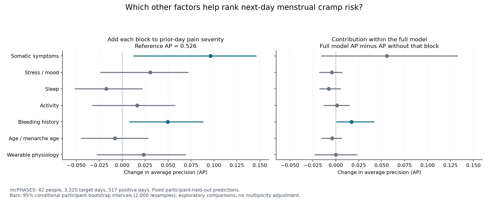

# Literature review and multifactor menstrual-pain analysis

Completed November 1, 2026. All results below are measured from saved predictions; no paper’s participant records were downloaded or merged into our cohorts.

## Research question

**Do prior-day bodily symptoms, sleep, stress/mood, activity, bleeding history and wearable physiology improve next-day moderate-or-higher cramp prediction beyond prior-day cramp severity?**

The project now tests multiple domains explicitly. Its quality rests on appropriate measurements, time ordering, participant-held-out comparisons and uncertainty—not on requiring every extra feature to improve performance. The four sources motivate hypotheses; their different populations, outcomes and time horizons do not establish next-day predictive validity for our features.

## 1. Datasets and findings in the four supplied papers

### 1. Painful periods (IASP explainer of Slater et al., 2015)

**Dataset:** Western Australian Pregnancy Cohort (Raine) Study. **Sample:** 432 young women; questionnaires at ages 20 and 22.

**Design and outcome:** Cross-sectional association analysis using menstrual-pain assessments and laboratory quantitative sensory testing. Menstrual pain VAS 0–10; grouped pain history and cold/pressure pain sensitivity.

**Measured attributes:** Cold pain threshold; Pressure pain threshold; Multisite musculoskeletal pain; Oral contraception; Smoking; Physical activity; BMI; Psychological distress; Sleep.

**What the findings support:** More severe menstrual pain was associated with greater experimental pain sensitivity after adjustment. The covariates were adjustment variables, not all established independent predictors.

**Use in our project:** Motivates broader symptom burden, activity, sleep and reproductive/clinical context; wearable temperature is not a QST cold-pain threshold.

**Data access:** Controlled application: Raine project and human-research ethics approvals required. No raw data obtained.

Source: [Painful periods (IASP explainer of Slater et al., 2015)](https://doi.org/10.1097/j.pain.0000000000000317) — supplied file `Painful periods - International Association for the Study of Pain (IASP).pdf`, PDF pages 1–3; primary study in references.

Current access policy: [Raine researcher FAQs](https://rainestudy.org.au/information-for-researchers2/frequently-asked-questions/).

Primary study DOI: [10.1097/j.pain.0000000000000317](https://doi.org/10.1097/j.pain.0000000000000317).

### 2. Menstrual Pain Trajectories and Their Psychological and Behavioral Predictors

**Dataset:** NorthShore University HealthSystem adult longitudinal dysmenorrhea research cohort. **Sample:** 157 analytic participants, ages 18–45, with at least two of three visits: screening, year 1, year 2; recruitment methods describe 345 participants.

**Design and outcome:** Growth-mixture pain trajectories over two years and multinomial logistic classification of trajectory membership. Recalled menstrual pain over the preceding three months, 0–100 VAS; not daily next-day forecasting.

**Measured attributes:** Pain Catastrophizing Scale (13 items); BSI-18 somatization subscale; PROMIS sleep disturbance; PROMIS depression; PROMIS anxiety; Nonmenstrual pelvic pain; Age and childbirth/reproductive history.

**What the findings support:** Somatic symptoms distinguished worsening from high-stable pain (p=.044); the detailed table also shows depression distinguishing improving from high-stable pain (p=.041). Sleep, catastrophizing and anxiety contrasts were not significant. The abstract emphasizes only somatic symptoms.

**Use in our project:** Prioritize a somatic-symptom feature block, while labeling our diary symptoms as proxies rather than BSI/PROMIS scores.

**Data access:** Public thesis, but no public participant-level data download or guaranteed data-sharing route identified in the supplied source. Research-team access would need verification; no raw data obtained.

Source: [Menstrual Pain Trajectories and Their Psychological and Behavioral Predictors](https://ecommons.luc.edu/luc_theses/4410/) — supplied file `Menstrual Pain Trajectories and Their Psychological and Behaviora.pdf`, PDF pages 23–28 (methods), 43–47 (predictors), 51–54 (limitations).

Publication page: [Hannah Marie Alves Hagy, 2021](https://ecommons.luc.edu/luc_theses/4410/).

### 3. A multidimensional appraisal of early menstrual pain experience

**Dataset:** Early Menstrual Pain Impact on Multisensory Hypersensitivity (EMPATHY). **Sample:** 149 first-period diaries and 114 fourth-month diaries; premenarchal enrollment ages 9–14 in northern Chicagoland.

**Design and outcome:** Prospective adolescent inception cohort; premenarchal baseline assessment followed by daily diaries during selected menstrual periods. Daily pain 0–10, bleeding, medication and interference; fourth-month maximum-pain groups <3 versus ≥3.

**Measured attributes:** PROMIS pediatric anxiety, depression, stress and affect; Pain Catastrophizing Scale; CSSI-24 somatic symptoms; BMI and pubertal stage; Maternal pain history; Pressure thresholds and conditioned pain modulation; Bladder sensitivity; Bleeding; Analgesic use; Nonmenstrual pelvic pain, dysuria and dyschezia.

**What the findings support:** Baseline psychosocial, demographic and laboratory sensitivity measures did not distinguish later low/higher pain groups. This is important counter-evidence to treating plausible factors as proven predictors.

**Use in our project:** Evaluate domains with explicit null hypotheses and preserve negative results. Measure current context and timing; do not transfer adult associations directly to adolescents.

**Data access:** Public paper; no public participant-level download identified in the supplied paper. Research-team access is unverified; no raw data obtained.

Source: [A multidimensional appraisal of early menstrual pain experience](https://pmc.ncbi.nlm.nih.gov/articles/PMC11165568/) — supplied file `nihms-1963694.pdf`, PDF pages 3–5 (methods), 6–9 (results/discussion), 20 (baseline predictor table).

Publication page: [Tu et al., 2024](https://pmc.ncbi.nlm.nih.gov/articles/PMC11165568/).

Primary study DOI: [10.1016/j.ajog.2024.01.017](https://doi.org/10.1016/j.ajog.2024.01.017).

### 4. Measuring Menstrual Discomfort: A comparison of interview and diary data

**Dataset:** DES Reproductive Health Study, 1990, daughters from the Chicago prenatal DES trial. **Sample:** 358 with at least one cycle; 357 with enrollment response; 324 with ≥4 cycles for frequency analysis; 313 for pain-day count analysis; ages 37–39.

**Design and outcome:** Comparison of a baseline retrospective frequency question with up to six months of prospective daily diaries. Presence/frequency of cramps or backache and medication use, not daily pain severity.

**Measured attributes:** Daily bleeding and spotting; Daily discomfort; Medication for menstrual pain; Baseline menstrual and reproductive history.

**What the findings support:** Agreement was modest (weighted kappa .35); discomfort clustered near bleeding onset. Medication-associated pain agreed somewhat better with recall.

**Use in our project:** Prefer observed daily outcomes, include past-only bleeding timing and handle medication carefully. Do not create pain labels from medication use.

**Data access:** No public participant-level release identified in the supplied paper. Do not assume that a generic DES dataset is the same cohort. No raw data obtained.

Source: [Measuring Menstrual Discomfort: A comparison of interview and diary data](https://pmc.ncbi.nlm.nih.gov/articles/PMC2650252/) — supplied file `nihms87949.pdf`, PDF pages 2–5 (population, measures and results).

Publication page: [Jukic et al., 2008](https://pmc.ncbi.nlm.nih.gov/articles/PMC2650252/).

Primary study DOI: [10.1097/EDE.0b013e318187ac9e](https://doi.org/10.1097/EDE.0b013e318187ac9e).

### Important differences between these datasets and our target

The IASP file is an explainer of a study, rather than a new dataset paper. The adult thesis models recalled pain trajectories over years. EMPATHY has prospective severity diaries but concerns adolescents around menarche and has no public raw download identified here. The DES paper measures discomfort presence/frequency rather than daily severity. None supplies a verified, immediately available external dataset matching prior-day wearables plus next-day pain severity.

The adult thesis recruited a pain-enriched sample and retained 157 participants with sufficient follow-up. Its reported recruitment population was predominantly White and nulliparous; attrition and recruitment affect generalization. EMPATHY was predominantly White and relatively affluent. The DES analysis has a narrow age range and a specific historical recruitment frame. Results cannot be pooled as if all papers studied the same population.

## 2. Evidence-to-feature mapping

| Domain | Literature motivation | What we can actually model | Interpretation |
|---|---|---|---|
| Bodily symptom burden | BSI-18 somatization in the thesis; CSSI-24 in EMPATHY; multisite pain in Raine | mcPHASES prior-day headache, fatigue, bloating, indigestion, breast soreness; MPIS prior-day symptom count | Diary symptom proxies, not validated somatization scores |
| Sleep | PROMIS sleep disturbance in the thesis; sleep covariate in Raine | mcPHASES prior-day sleep difficulty, duration, awake minutes, efficiency, score, deep sleep, restlessness | Testable domain; the thesis did not show significant sleep contrasts |
| Stress and mood | Psychological assessments in Raine, the thesis and EMPATHY | mcPHASES prior-day stress and mood swings; MPIS prior-day mood | These do not measure clinical depression, anxiety or catastrophizing |
| Bleeding and timing | DES discomfort near bleeding onset; EMPATHY bleeding diaries | mcPHASES prior-day flow and observed bleeding clocks; MPIS prior-day menstruation, baseline cycle length and period duration | Only information observed before the prediction day; no retrospective phase labels |
| Activity and physiology | Activity covariate in Raine; plausible contextual physiology | mcPHASES sedentary/light/moderate/vigorous activity, resting HR, HRV, respiratory rate, nightly skin temperature, Fitbit stress score | Wearables measure behavior/physiology, not experimental pain sensitivity; wearable rationale is partly exploratory |
| Reproductive and clinical context | Age, BMI, menarche, parity, contraception and nonmenstrual pain in the sources | mcPHASES approximate age and menarche age; MPIS BMI, menarche age, cycle length, period duration, live births, endometriosis/adenomyosis status, nonmenstrual pain frequency | Baseline self-reports; suspected and diagnosed conditions remain distinct |
| Medication | Daily analgesic use in EMPATHY and DES | MPIS prior-day tablet count | May reflect both symptom burden and treatment; not a treatment-effect estimate or a pain-label substitute |
| Catastrophizing, validated mental-health scores, family history, QST | PCS, PROMIS, maternal history and lab testing in the sources | Not measured in the current model tables | Require actual new measurements; do not fabricate from proxies |

## 3. Work implemented and safeguards

The mcPHASES extension evaluates **29 candidate predictors**: ordinal prior-day cramp severity plus 28 features across seven non-history domains. This replaces the previous binary-history representation for the main incremental comparisons, adds five somatic symptoms, approximate age, menarche age and a conservative observed-flow-onset clock. A richer pain-history comparator prevents attributing gains merely to recovering severity information lost in a binary prior-pain flag.

All changing features are joined from exact day t−1; they are not shifted across missing days. Age is approximated as 2022 minus birth year. The onset clock starts only after an observed adjacent-day transition from no/spotting flow to light-or-heavier flow; a gap or missing flow resets it. It is a bleeding-history proxy, not a hormone-derived cycle phase. The target remains the original project definition: moderate/high/very high cramp reports versus lower levels.

The original 3,320 target days, 42 participants and five participant-held-out folds are preserved. The original 21-feature forest’s predictions are reproduced to 1e−12. Fixed forest settings are unchanged (200 trees, depth 6, minimum leaf 5, balanced subsampling, seed 42). Logistic regression provides a second model family. No threshold tuning or test-fold hyperparameter search was performed.

For every model, missingness filtering (>60% missing), median imputation with indicators, scaling and fitting occur inside training folds. The full specification offers 29 features, but the new onset clock is observed on only 1,288/3,320 days and survives filtering in **one of five folds**; the other 28 candidates survive all five. Thus “29” describes the candidate specification, not a claim that every fold used 29 complete measurements.

The analysis includes pain-only baselines, each added domain, the full model, seven leave-one-domain-out models and models without prior-day cramp severity. These are block ablations rather than causal explanations or proof that each individual symptom is useful.

MPIS adds seven baseline clinical/reproductive variables to its original observed-only pairs. Missing/sentinel values are handled explicitly, including unknown live births; suspected diagnosis is not converted to confirmed disease. It retains the ≥4/10 project threshold and leave-one-participant-out folds. The previous MPIS history model is reproduced exactly. Its primary cohort remains 105 observed pairs from 14 people with 14 positive days; the stricter pre-intervention sensitivity has 77 pairs from 13 people.

The studies remain separate. No current-day outcome proxies, future cycle labels, source-imputed targets, model-generated labels or participant identifiers enter the predictors. Data from the four papers have not been obtained; their published findings inform feature design. Detailed features and predictions stay in ignored private run folders.

## 4. Initial results from the expanded analysis

### mcPHASES: adding factors beyond pain severity

| Model | Average precision | Balanced accuracy | Macro F1 |
|---|---:|---:|---:|
| Binary pain-history forest (earlier reference) | 0.460 | 0.773 | 0.781 |
| Ordinal pain-severity forest | 0.526 | 0.804 | 0.754 |
| Pain severity + somatic symptoms | 0.623 | 0.795 | 0.761 |
| Pain severity + stress / mood | 0.557 | 0.796 | 0.756 |
| Pain severity + sleep | 0.509 | 0.799 | 0.754 |
| Pain severity + activity | 0.543 | 0.803 | 0.760 |
| Pain severity + bleeding history | 0.576 | 0.796 | 0.740 |
| Pain severity + age / menarche age | 0.518 | 0.784 | 0.746 |
| Pain severity + wearable physiology | 0.550 | 0.799 | 0.764 |
| Full model: 29 candidate predictors | 0.602 | 0.781 | 0.766 |
| Full model excluding cramp history | 0.495 | 0.718 | 0.714 |
| Original 21-feature forest | 0.555 | 0.773 | 0.770 |

Average precision (AP) evaluates ranking across score cutoffs; the positive prevalence is 0.156. Balanced accuracy averages sensitivity and specificity. Macro F1 averages the two class F1 scores. A better AP does not necessarily mean a better classifier at the fixed decision threshold, and these scores are not calibrated clinical probabilities.

**Somatic symptoms are the strongest added block for ranking in the pain-only comparison:** AP rises from 0.526 to 0.623; paired change +0.096 [+0.012, +0.146]. Balanced accuracy falls from 0.804 to 0.795, and macro F1 changes from 0.754 to 0.761. This supports further investigation of the symptom block; it does not identify a causal effect or establish which individual symptom contributes.

**Bleeding history also helps ranking:** paired AP change +0.050 [+0.008, +0.088], while macro F1 falls from 0.754 to 0.740. Other block-level AP intervals include zero. No general claim that sleep, mood or every wearable improves prediction is supported.

**The full model improves ranking beyond severity alone:** AP 0.526 → 0.602, paired change +0.076 [+0.013, +0.120]. Balanced accuracy decreases from 0.804 to 0.781; the paired interval for that change is -0.023 [-0.053, -0.004]. Compared with the original 21-feature forest, AP rises from 0.555 to 0.602, but that paired change is uncertain: +0.047 [-0.010, +0.099].

**Within the full model, evidence is less decisive for somatic symptoms:** full AP 0.602 versus 0.547 without somatic symptoms, paired change +0.055 [-0.015, +0.132]. The interval includes zero. Removing bleeding lowers AP to 0.585; its paired contribution is +0.017 [+0.001, +0.041]. This distinction prevents overstating the pain-only block comparison as unique importance after all other factors.

**There is predictive signal without previous-day cramps:** the non-history forest has AP 0.495, balanced accuracy 0.718 and macro F1 0.714. This supports a multifactor signal in this cohort, while retaining pain history gives better classification. Logistic full-model AP is 0.537 versus 0.528 for severity alone, with paired interval +0.009 [-0.054, +0.062]; the forest result is not consistent across model families.



The left panel adds each domain to prior-day pain severity. The right panel compares the full model with an otherwise identical model omitting that domain. Intervals resample participants, condition on fixed held-out predictions and have no multiple-comparison adjustment.

### MPIS: clinical/reproductive factors in a second cohort

| Model | Average precision | Balanced accuracy | Macro F1 |
|---|---:|---:|---:|
| Pain history only | 0.461 | 0.720 | 0.684 |
| Pain + clinical/reproductive block | 0.537 | 0.775 | 0.701 |
| Pain + clinical + background | 0.499 | 0.761 | 0.719 |
| Full literature model | 0.490 | 0.690 | 0.668 |
| Full model excluding pain history | 0.477 | 0.659 | 0.650 |

The clinical/reproductive block increases primary balanced accuracy from 0.720 to 0.775, but the paired 95% interval is +0.055 [-0.014, +0.131]. Its AP gain is also uncertain: +0.076 [-0.111, +0.234]. Only 14 people and 14 positive days support this comparison.

In the stricter pre-intervention-only sensitivity, clinical-block balanced accuracy is 0.745 versus 0.745 for history alone, and macro F1 falls from 0.724 to 0.686. Adding every feature does not consistently help. MPIS has no wearable recordings. These are separately fitted within-MPIS models, not external evaluation of a frozen mcPHASES model; participant non-overlap and source provenance remain unverified.

### Limits of the evidence

All new analyses are exploratory extensions of previously inspected cohorts. Reported 95% intervals use 2,000 paired participant bootstrap resamples of fixed out-of-fold predictions; they do not refit models, correct many comparisons or account for research decisions made after seeing earlier results. Missingness, shared diary reporting, symptom correlations and prior pain influencing sleep/activity can contribute to observed associations. Repeated days are not independent people. Neither these models nor the papers establish causal drivers or treatment effects.

## 5. What to say in the project

> We evaluated menstrual-pain forecasting as a multifactor problem, using prior-day bodily symptoms, sleep, mood/stress, activity, bleeding history and wearable physiology, together with reproductive context. Somatic symptoms improved risk ranking beyond prior-day pain severity in mcPHASES, while gains in fixed-threshold classification and a second cohort were inconsistent. Pain history remains an important benchmark rather than the only factor considered.

The project can support a careful conclusion about **which measured domains add predictive information under this evaluation**. It cannot support “all these attributes cause menstrual pain,” “psychological factors always predict pain,” or “wearables independently diagnose pain.”

## 6. Measurement priorities and remaining finalization

For a future prospective extension, prioritize validated somatic-symptom and sleep instruments, short validated depression/anxiety measures and PCS if relevant; capture analgesic type/dose/timestamp and hormonal-contraception status; record diagnosed versus suspected conditions, nonmenstrual pain, reproductive/family history and bleeding timing. These are new measurements, not values recoverable from the current proxies. Any claimed clinical diagnosis needs appropriate verification. Experimental QST would require a separate protocol and is not essential to finish this course project.

The current literature review, feature extension and fixed-model experiments are completed. Remaining delivery tasks are final table/figure review, incorporating the new evidence into the written report and presentation, rehearsal and submission by **November 30, 2026**. Restricted-dataset applications, new participant collection and independent prospective validation are optional future research, not unfinished major course milestones. The older October presentation is preserved and has not automatically been overwritten.

## 7. Reproduce and inspect

```sh
.venv/bin/python -m src.literature_analysis
.venv/bin/python scripts/report_literature.py
.venv/bin/python -m pytest -q
```

Prerequisites: existing authorized mcPHASES extraction and completed `src.mcphases`/`src.mpis` runs. Modeling preserves original inputs and run directories.

- `reports/literature_evidence.json`: paper-by-paper dataset, measures, findings, source pages and access notes.
- `reports/literature_factor_results.json`: aggregate metrics, bootstrap intervals, feature coverage, fold retention and hashes.
- `reports/runs/literature_factors/`: ignored participant-level features/predictions, detailed aggregate CSVs and retained-feature audit.
- `src/literature_analysis.py`: modeling and timing rules.
- `tests/test_literature_analysis.py`: onset-clock causality, gap handling and clinical sentinel/diagnosis checks.
- `reports/figures/literature_feature_blocks.png` and `.svg`: reusable scientific figure.
