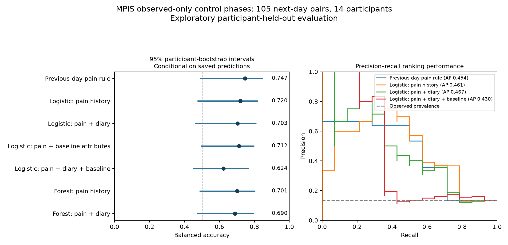

# MPIS observed-only next-day pain analysis

Analysis date: November 1, 2026. This is an exploratory replication of the forecasting question in a separate dataset. Models are trained and evaluated within MPIS with held-out participants. This is not external evaluation of the frozen mcPHASES model, and it cannot test wearable utility because MPIS has no wearable recordings.

## Source audit

[MPIS Study Data](https://zenodo.org/records/21538147), DOI 10.5281/zenodo.21538147, CC BY 4.0. All eight source files match their downloaded checksums. English and German tables describe the same participants; AI-extracted free-text outputs are not used as outcomes or predictors.

- Published grid: **2160 rows, 36 participants**, nominally 60 days each.
- **1856 rows (85.9%) are imputed**, all excluded from both targets and prior-day inputs.
- Only **304 observed daily reports from 19 people** remain. **17 enrolled participants have no observed daily report** in this release.
- Observed original pain question and supplied `pain` column agree. Pain ranges from 0 to 9 in the observed data, despite a 0–10 instrument. The binary pain-present question has one yes response paired with a severity of zero; the numeric severity remains authoritative.
- Exact adjacent observed pairs: **178 days from 16 people**. All retained study-day pairs also have a one-day difference in the published UTC calendar dates. No forward-fill or previous-observation join is used across missing days.
- Baseline questionnaire linkage is one-to-one by the published pseudonymous participant ID. Negative sentinel codes −997/−998/−999 are missing, not numeric values. Six chosen baseline categorical attributes plus BMI form the baseline feature block.

The source states that timestamps were changed. Publication/creation metadata and the trial-registry reference also contain inconsistencies, and the linked analysis repository was unavailable during inspection. Absolute dates, season, weekday, source-generated future phase labels, and source-imputed features are excluded. Preserved relative ordering is checked against the published timestamp differences, but original timing and independent recruitment cannot be established from these files alone.

## Outcome, predictors and evaluation

The target is **next-day observed pain ≥4/10**, an explicit project threshold. It is not a clinical cutoff and is not an exact scale conversion of mcPHASES verbal categories. The outcome is not imputed. Both members of every pair must be observed.

Predictors available by the previous report: continuous previous-day pain, previous-day tablet count, pain-related negative mood impact, symptom count, and menstruation status. Baseline attributes: age group, working while studying, alcohol, smoking, vigorous and moderate activity outside menstruation, and BMI. These are baseline habits rather than measured daily activity. No baseline pain severity, current-day symptoms, current pain, imputation-generated fields, IDs, absolute dates, or free-text model labels enter any model. No daily stress, sleep, or wearable measurements are available in the chosen source tables. Conditional symptom reporting can make diary attributes redundant with pain history. This is a next-calendar-day retrospective task; varying report times, shifted dates and unconfirmed questionnaire lookback windows prevent a claim of an exact 24-hour operational forecast.

Primary scope is **both days in control phases A1/A2**, yielding **105 pairs, 14 participants, and 14 positive outcomes (13.3%)**. A2 follows massage, so carry-over effects remain possible. The stricter A1-only analysis excludes post-intervention control days. An all-phase sensitivity includes treatment periods and six A1-to-B transitions; it estimates a different case mix.

Leave-one-participant-out evaluation prevents rows from the same person entering both train and test. Fixed logistic regression uses C=0.1 and balanced classes. Fixed random forests use 200 trees, maximum depth 3, minimum leaf size 5, balanced subsample classes and seed 42. All numeric imputation/scaling and categorical encoding are fitted within the training fold. No model/threshold search or post-result feature selection is performed. Learned models use a fixed 0.5 classification threshold.

The persistence classifier predicts the previous day's ≥4/10 class. Its ranking score is previous pain/10, not a calibrated probability. Always-negative is a constant reference. Within-family feature comparisons isolate the added diary or baseline block without changing model settings. The study has only a few independent participants, even though there are more daily rows.

## Primary results: observed control phases

| Model | Macro F1 | Balanced accuracy | AP | Detected positives | False alarms |
|---|---:|---:|---:|---:|---:|
| Logistic: pain history | 0.684 | 0.720 | 0.461 | 8/14 | 12/91 |
| Logistic: pain + diary | 0.656 | 0.703 | 0.467 | 8/14 | 15/91 |
| Logistic: pain + baseline attributes | 0.712 | 0.712 | 0.431 | 7/14 | 7/91 |
| Logistic: pain + diary + baseline | 0.620 | 0.624 | 0.430 | 5/14 | 10/91 |
| Forest: pain history | 0.689 | 0.701 | 0.373 | 7/14 | 9/91 |
| Forest: pain + diary | 0.668 | 0.690 | 0.363 | 7/14 | 11/91 |
| Previous-day pain rule | 0.740 | 0.747 | 0.454 | 8/14 | 7/91 |
| Always low/no pain | 0.464 | 0.500 | 0.133 | 0/14 | 0/91 |

**Main finding:** the previous-day pain rule has the highest primary balanced accuracy (**0.747**) and macro F1 (**0.740**). It detects **8 of 14** moderate-or-higher pain days, with **7 false alarms among 91 negative days**. Its 95% conditional participant-bootstrap interval for balanced accuracy is **[0.488, 0.849]**.

Additional diary fields do not improve classification over the matched pain-only model: logistic balanced accuracy changes from **0.720 to 0.703**. Their AP point estimate increases slightly, but the paired AP-difference interval **[-0.165, 0.149]** crosses zero. Adding baseline attributes to pain-only logistic regression gives balanced accuracy **0.712**, with a paired difference interval **[-0.062, 0.053]**. The full diary-plus-baseline model falls to **0.624**. These results show no consistent added predictive value from the attribute blocks in this small cohort; they do not establish that the attributes are irrelevant.

AP means average precision. The prevalence reference is **0.133**. These are pooled held-out day scores; equal-person-weighted metrics are also retained in the aggregate JSON to show sensitivity to unequal reporting frequency. False alarms are counts among actual negative days, not a clinical alert-rate estimate.

## Sensitivity: pre-intervention A1 only

| Model | Macro F1 | Balanced accuracy | AP | Detected positives | False alarms |
|---|---:|---:|---:|---:|---:|
| Logistic: pain history | 0.724 | 0.745 | 0.486 | 8/13 | 8/64 |
| Logistic: pain + diary | 0.697 | 0.730 | 0.512 | 8/13 | 10/64 |
| Logistic: pain + baseline attributes | 0.753 | 0.761 | 0.479 | 8/13 | 6/64 |
| Logistic: pain + diary + baseline | 0.651 | 0.660 | 0.511 | 6/13 | 9/64 |
| Forest: pain history | 0.708 | 0.715 | 0.444 | 7/13 | 7/64 |
| Forest: pain + diary | 0.681 | 0.699 | 0.425 | 7/13 | 9/64 |
| Previous-day pain rule | 0.753 | 0.761 | 0.511 | 8/13 | 6/64 |
| Always low/no pain | 0.454 | 0.500 | 0.169 | 0/13 | 0/64 |

In this stricter scope, the pain-plus-baseline logistic model and persistence tie on balanced accuracy and macro F1, while their ranking scores differ. This does not establish superiority of either approach. The small sample and changes across scopes limit model-ranking conclusions.

## Sensitivity: all observed phases

| Model | Macro F1 | Balanced accuracy | AP | Detected positives | False alarms |
|---|---:|---:|---:|---:|---:|
| Logistic: pain history | 0.681 | 0.743 | 0.464 | 11/18 | 20/160 |
| Logistic: pain + diary | 0.669 | 0.718 | 0.466 | 10/18 | 19/160 |
| Logistic: pain + baseline attributes | 0.611 | 0.635 | 0.347 | 7/18 | 19/160 |
| Logistic: pain + diary + baseline | 0.610 | 0.605 | 0.356 | 5/18 | 11/160 |
| Forest: pain history | 0.689 | 0.728 | 0.370 | 10/18 | 16/160 |
| Forest: pain + diary | 0.663 | 0.697 | 0.423 | 9/18 | 17/160 |
| Previous-day pain rule | 0.744 | 0.750 | 0.436 | 10/18 | 9/160 |
| Always low/no pain | 0.473 | 0.500 | 0.101 | 0/18 | 0/160 |

## Uncertainty and interpretation

The report records **2000 paired participant-cluster bootstrap resamples** of fixed held-out predictions. These intervals do not refit models, account for hyperparameter search, or establish clinical validity. Participants with longer reporting histories contribute more rows to pooled metrics; equal-person-weighted sensitivity is included. A bootstrap sample lacking an outcome class cannot define balanced accuracy and is omitted for that metric; valid-resample counts are reported.

The aggregate JSON contains point estimates, intervals, and paired differences for diary additions and baseline additions. These prespecified comparisons are exploratory, with no multiple-testing correction. Apparent differences may reflect individual symptom patterns, reporting behavior, treatment phases or selective adherence. They do not establish that alcohol, activity, BMI or mood causes menstrual pain.

This dataset adds genuine observed consecutive-day reports, but its 86% imputed grid and small observed sample constrain the strength of any conclusion. Reporting only the 2,160 filled rows would substantially exaggerate the available evidence. The imputed values derived from baseline pain cannot be treated as independent targets for evaluating baseline attributes.

## Reproduce and saved outputs

Run `.venv/bin/python -m src.mpis`, then `.venv/bin/python -m pytest -q`. Original files are unchanged. Source hashes, software versions and complete analysis settings are recorded in `reports/mpis_results.json`.

Participant-level observed rows, consecutive-day pairs, baseline features, folds, predictions and source-audit details stay ignored under `reports/runs/mpis/`. Aggregate metrics and uncertainty appear in `reports/mpis_results.json`; the figure is in `output/analysis/mpis_results.png`. The mcPHASES and PhysioPain analyses are unchanged.
