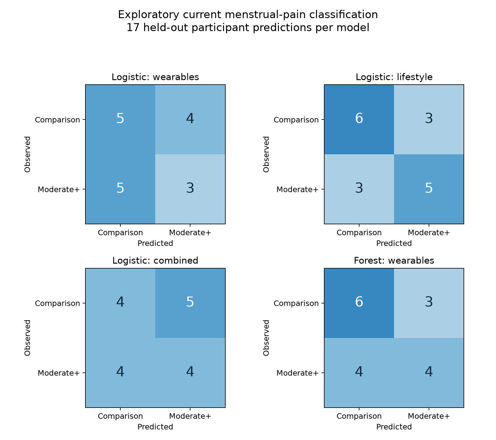

# PhysioPain exploratory analysis

Analysis date: November 1, 2026. This is a separate experiment in classifying current pain during a short recording. The completed mcPHASES next-day forecasting results remain the primary project analysis.

## Data and label audit

- The verified extracted archive contains 1,011 entries and 5,235,238,091 uncompressed bytes. Source: [PhysioPain v4](https://data.mendeley.com/datasets/mf2cgph9cy/4), CC BY 4.0. [Study methods](https://pmc.ncbi.nlm.nih.gov/articles/PMC12410463/).
- English survey: **99 people**. The Turkish workbook is a translation, not additional participants.
- Raw wristband recordings: **86 people**, also represented in the individual processed 4 Hz files. **13 survey participants lack a raw wristband archive**. These actual counts differ from the paper's claimed 93 usable physiological participants.
- Original survey explicitly identifies **9 menstrual-pain participants**. Current severity: {'Moderate': 3, 'Very severe': 3, 'Severe': 2, 'Mild': 1}.
- The processed menstrual folder has **11 people**, including **2 reporting abdominal pain**, excluded from the modeled cohort. Processed severity differs from current survey severity in **3** menstrual-folder records. The current-pain survey item, rather than general menstrual severity or the supplied processed label, defines the target.

## Cleaning and feature preparation

Read original E4 ZIP files in place. Remove the first two rows (UTC epoch and sampling rate) from regularly sampled signals. The packaged processed files include sampling-rate values in the signal columns, with associated filtering/resampling artifacts, so they are used for the label audit only.

Align channels in UTC and use the same **10-minute window**, starting 30 seconds after the latest channel start, for every recording. This avoids using different recording durations as different feature windows. Broad validity bounds: HR 30–220 bpm, EDA 0–100 microsiemens, temperature 20–42 °C, acceleration ±2 g (raw units divided by 64). Use a regular channel's summaries only with at least 80% valid samples of the expected window. These fixed engineering bounds are not clinical diagnoses. No selection by outcome or model performance occurs.

Nine wearable features: median and IQR of HR, EDA, and temperature; acceleration-magnitude SD; median acceleration-change rate; IBI-derived RMSSD. RMSSD requires at least 30 adjacent valid interval pairs, intervals 0.3–2 seconds, and temporal continuity. It is exploratory session HRV, not a standardized nocturnal/resting HRV measurement. Seven survey predictors cover habitual sleep, sleep before the test, sleep difficulty, stress, exercise, diet, and water intake. No pain questions, pain type, ID, recording timestamp, or demographic sex enters the predictors.

## Modeled cohort and evaluation

The cohort has **17 female participants**: **8 with current moderate-or-higher menstrual pain**, **8 reporting no pain**, and **1 with mild menstrual pain**. Explicit no-pain reports define controls even when the severity follow-up is blank; missing pain labels in other groups are not filled. Other pain types and ambiguous abdominal-pain cases are excluded.

One summary row per person prevents sensor samples and resampled copies from inflating sample size. Leave-one-participant-out evaluation keeps each test person out of all training. Fixed logistic regression (C=0.1, balanced classes) tests wearables, lifestyle, and their combination. A shallow fixed random forest uses wearables. Median imputation, missingness indicators, scaling, and categorical encoding are fit inside each training fold. The probability threshold is fixed at 0.5. No tuning or result-driven feature selection was performed. OOF predictions are exploratory and cannot be treated as an untouched final test set for later tuning.

| Model | Macro F1 | Balanced accuracy | Average precision | ROC-AUC | Positives detected | False positives |
|---|---:|---:|---:|---:|---:|---:|
| logistic_wearables | 0.463 | 0.465 | 0.587 | 0.444 | 3/8 | 4/9 |
| logistic_lifestyle | 0.646 | 0.646 | 0.719 | 0.625 | 5/8 | 3/9 |
| logistic_combined | 0.471 | 0.472 | 0.611 | 0.500 | 4/8 | 5/9 |
| forest_wearables | 0.582 | 0.583 | 0.587 | 0.611 | 4/8 | 3/9 |
| always_negative | 0.346 | 0.500 | 0.471 | 0.500 | 0/8 | 0/9 |

Average-precision prevalence reference: **0.471**. All metrics pool the held-out participant predictions. The always-negative classifier is a constant reference, not a fitted history model. A single person's classification changes recall by 1/8 and specificity by 1/9. Model rankings and feature utility are therefore uncertain. No significance or reliable attribution claim is made. Correlated physiology, movement, recording conditions, and feature missingness may explain apparent differences.

The lifestyle logistic model has balanced accuracy **0.646**, compared with **0.465** for wearable logistic regression and **0.472** for the combined model. Adding wearables did not improve the lifestyle model's held-out balanced accuracy or average precision in this experiment. The wearable forest's balanced accuracy is **0.583**. This does not demonstrate reliable wearable utility or establish that particular lifestyle factors cause or predict future menstrual pain.

## What this adds to the project

The work provides an independently sourced data audit, reproducible raw-signal cleaning, lifestyle and wearable features, and a small current-pain experiment. It establishes that public dataset folder labels and advertised participant counts need to be checked before modeling.

It does **not** establish external validation of next-day menstrual-pain prediction. These recordings contain no consecutive daily wearable history or next-day pain outcome. There is only one low-severity menstrual-pain participant, so a within-menstrual severity model cannot sustain both classes in every leave-one-person-out training fold. The control contrast changes the scientific question. Different recruitment is reported in the publication, but participant-level non-overlap with mcPHASES is not verified here.

Next analysis step: review this exploratory result for inclusion as a supplementary audit. Direct external forecast evaluation still requires a longitudinal cohort with compatible pain severity, prior-day predictors, IDs, dates, and confirmed independence. Do not pool these sessions into mcPHASES or replace the primary forecasting scores with these metrics.

## Reproduce and outputs

First use a Python interpreter with pandas/openpyxl to run `python -m src.physiopain --prepare-survey-only`. The bundled workspace Python supports this extraction. Then run `.venv/bin/python -m src.physiopain` for feature extraction and modeling. The existing local conversion is ready to use. Source workbook and converted CSV hashes are checked before analysis. Software versions and source hash are recorded in the summary. Run `.venv/bin/python -m pytest -q` for software checks.

Aggregate results are in `reports/physiopain_results.json`. Participant-level survey conversions, labels, features, quality records, fold assignments, and predictions remain ignored under `reports/runs/physiopain/`. The source archive and extracted records are unchanged.
